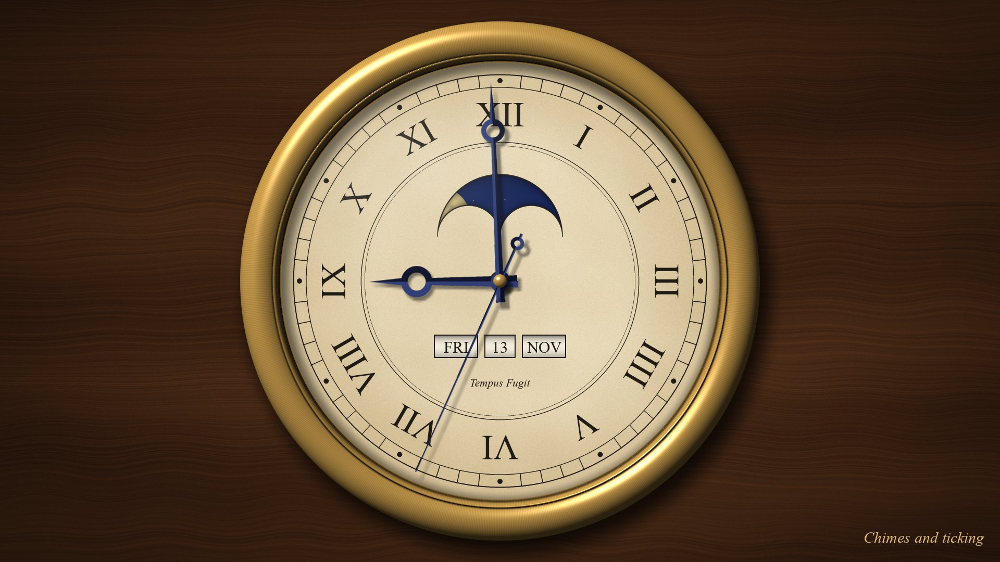
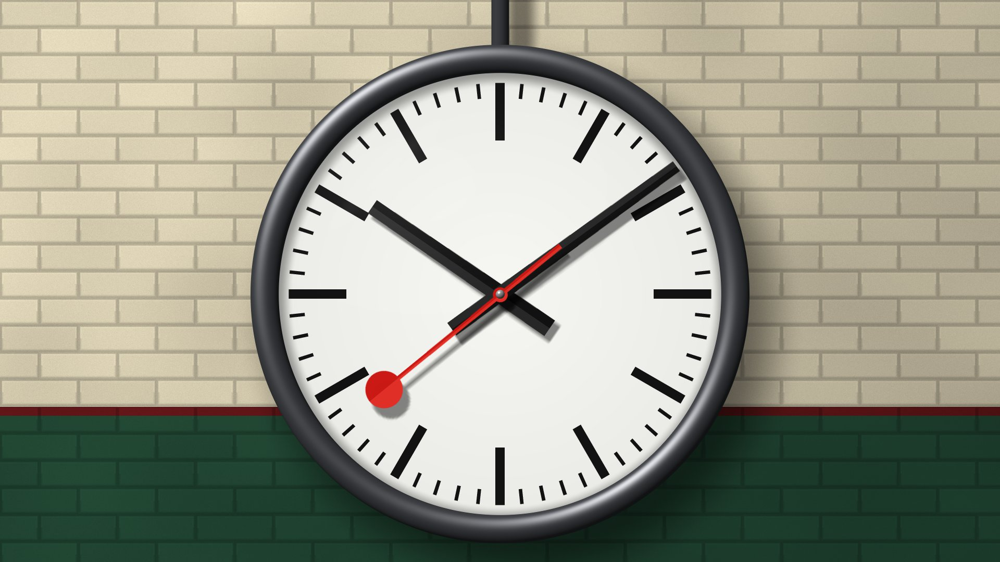
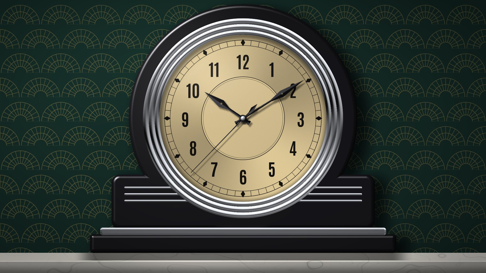
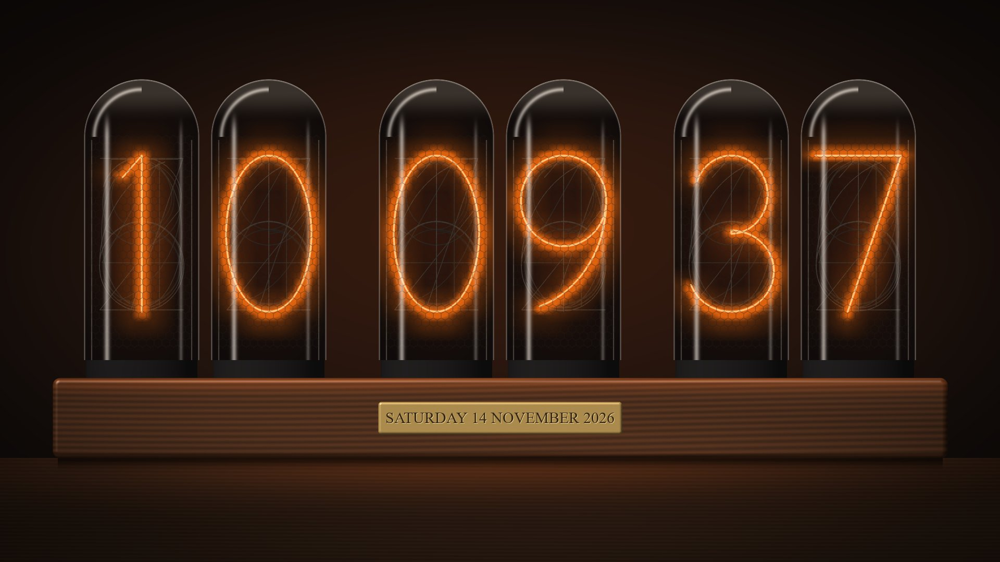
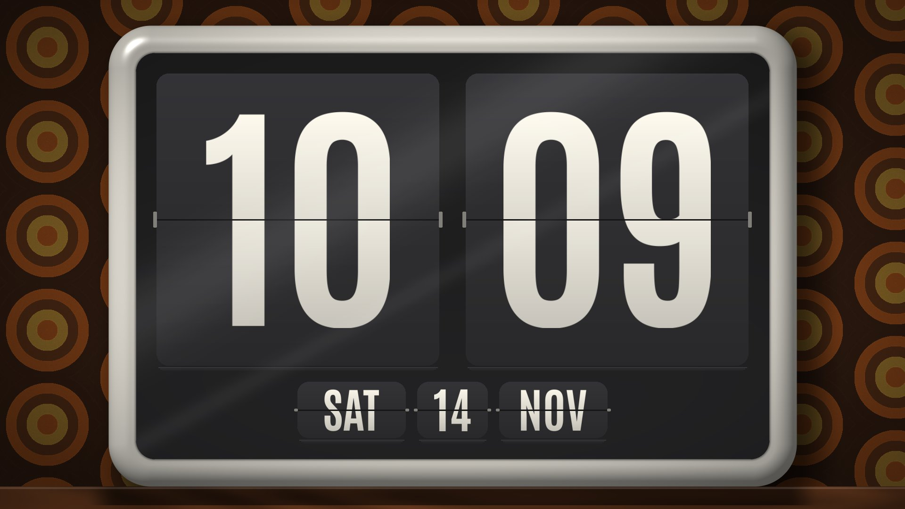
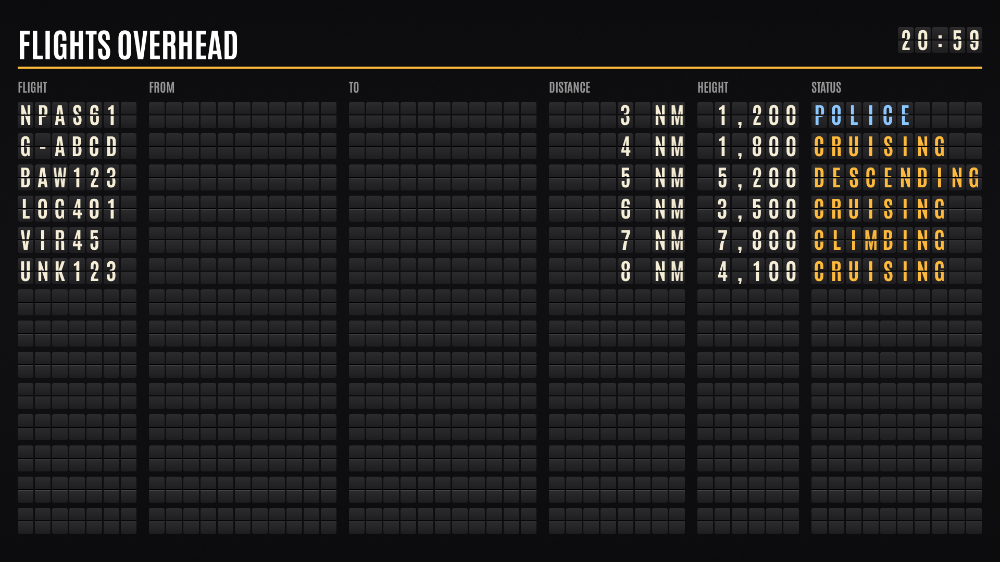
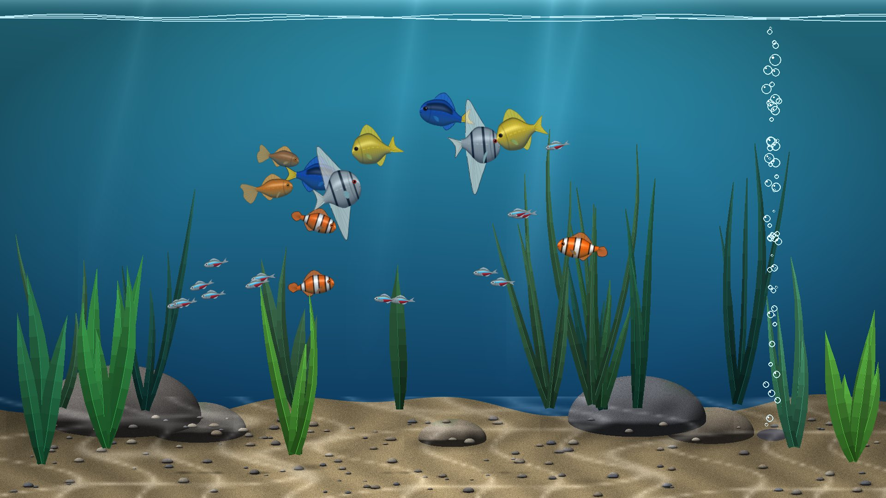
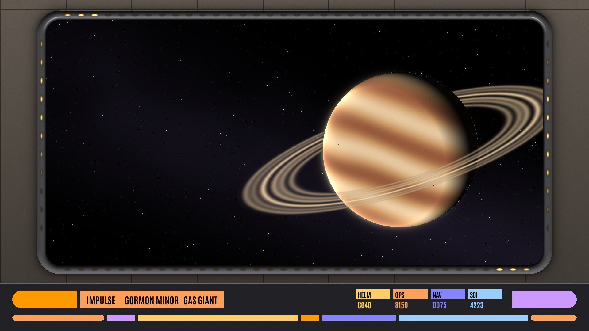
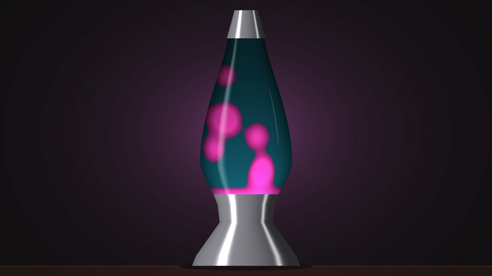

# LCARS display

A Star Trek LCARS-style display for a Raspberry Pi, written in Python with pygame. It fills
a 1920×1080 screen and shows one of eight screens at a time, changed with a push button on
the Pi's GPIO pins (another sets the volume of each screen) or the arrow keys:

- **LCARS**: an ambient screen that sits there looking busy. It shows a clock, the weather
  forecast, your next Google Calendar events, the Pi's CPU and memory use, and a radar of the
  aircraft near you from your own ADS-B receiver.
- **DeviantArt frame**: a picture frame. Every day it downloads 40 new landscape pictures
  from DeviantArt (10 of that day's Daily Deviations, and 30 chosen from artists, topics and
  tags you name), and shows them one after
  another, each fading into the next, with the title and artist in the corner.
- **Biomonitor**: the sickbay biomonitor, with a row of dials whose pointers drift around
  their normal ranges, and lamps that flash with the breathing and the heartbeat (which you
  can hear).
- **Clock**: a big clock, with five faces that the OK button goes round:
  - **Brass**: an old brass clock with Roman numerals, blued steel hands, a moon-phase window
    and windows for the day, the date and the month. It ticks, chimes the Westminster Quarters
    and strikes the hour.
  - **Railway**: a station clock hanging in front of a painted brick wall. Its red seconds hand
    sweeps round in 58.5 seconds and waits at the top for the minute hand to jump on. A station
    chime plays on the hour.
  - **Deco**: an Art Deco mantel clock in black lacquer and chrome, on a marble mantelpiece. It
    has a quick, high tick, three times a second, a ding-dong chime at the quarters, and a
    gong for the hours.
  - **Nixie**: six glowing Nixie tubes on a walnut base, with the date on a brass plate. The
    tubes run through all their digits every quarter of an hour, and the time pips sound
    before each hour.
  - **Flip**: a 1970s flip clock whose cards fall over with a clack, with the day, the date
    and the month below.

  Chimes are heard even behind the other screens; ticks only while the clock is shown. On the
  clock the SOUND button sets only how loud the ticks are (LOWER, LOW, MEDIUM, HIGH or OFF):
  the chimes always play at full volume, and holding SOUND down turns them off, or back on.
  Both are for the whole clock, whichever face is shown. Holding OK down plays the last chime
  again. It is silent from midnight to 9am. Each face is drawn the first time it is shown,
  which takes a few seconds. Its settings (which faces, the sound, the quiet hours, and each
  face's colours and sizes) are the `CLOCK_`, `BRASS_`, `RAILWAY_`, `DECO_`, `NIXIE_` and
  `FLIP_` ones in `settings.py`.
- **Departures board**: an old split-flap board, like a station's or an airport's, listing the
  aircraft your receiver can hear: flight, from, to, distance, height and what it is doing.
  It is brought up to date every 10 seconds (`DEPARTURES_UPDATE_SECONDS` in `settings.py`),
  when the letters clatter round to anything that has changed, and you can hear them.
- **Aquarium**: a tropical fish tank, with fish of several kinds, a school of neon tetras,
  swaying plants, bubbles and sunlight rippling on the sand. The OK button feeds the fish. At
  night (the clock's quiet hours) the light goes down and the fish rest.
- **Viewscreen**: the bridge's main viewscreen, set in its metal frame in the bulkhead, with
  running lights chasing round it and a console below. At impulse there is a planet or nebula
  ahead; the OK button (or a few minutes' wait) powers up and goes to warp, the lights turning
  blue, and it drops out later somewhere new: each planet and nebula is made up by the
  program, with a made-up name. The bridge hums, and the consoles chirp now and then.
- **Lava lamp**: a big lava lamp glowing in a dark room, whose colours change every hour (or
  with the OK button).

The sounds are all made by the program as it starts (see `synth.py`), so there are no sound
files apart from the biomonitor's heartbeat. How loud each one is, from 0 to 1, is set in
`settings.py` (and by the Pi's own volume). That is the loudest, HIGH: the SOUND
button turns each screen down from there (see [Buttons](#buttons)), except on the clock, where
it turns down only the ticks (and holding it down turns the chimes off or on).

| Sound | Setting |
| --- | --- |
| LCARS alerts | `LCARS_SOUND_VOLUME` (0.9) |
| Clock chimes | `CLOCK_CHIME_VOLUME` (0.6), whatever the SOUND button is set to; the Nixie pips are `NIXIE_PIP_LOUDNESS` (0.35) of that |
| Clock ticks (and the flip clock's clacks) | `CLOCK_TICK_LOUDNESS` (0.25) of the chimes' loudness at HIGH, 12 dB quieter; the SOUND button turns them down from there (`CLOCK_TICK_VOLUMES`) |
| Departures board flaps | `DEPARTURES_SOUND_VOLUME` (0.2) |
| Aquarium bubbles | `AQUARIUM_SOUND_VOLUME` (0.075) |
| Viewscreen hum, chirps and warp | `VIEWSCREEN_SOUND_VOLUME` (0.5) |

Each screen is in its own folder, and new ones can be added (see [Adding a screen](#adding-a-screen)).


*The LCARS screen, with the weather, the forecast and the aircraft radar. These aircraft are
the made-up ones from its test mode, one of them squawking an emergency, which turns the
screen red.*


*The DeviantArt frame, showing one of my own photos with the clock in the corner. A
downloaded picture has its title and artist shown in the bottom right corner.*


*The biomonitor screen.*


*The clock's brass face, with the moon's phase at the top of the dial and the day, the date
and the month below the middle.*


*The railway face: a station clock, whose red seconds hand waits at the top for the minute.*


*The deco face: a mantel clock in black lacquer and chrome.*


*The Nixie face, with the date engraved on the base.*


*The flip face, a 1970s flip clock.*


*The departures board, showing the LCARS screen's made-up test aircraft. From and To are only
filled in for flights to or from your own airport.*


*The aquarium.*


*The viewscreen at impulse, near one of its made-up planets.*


*The lava lamp, in one of its eight pairs of colours.*

## What you need

- A Raspberry Pi (it was written on a Pi 5) running Raspberry Pi OS, with a 1920×1080 screen
  on HDMI. It runs without a desktop, drawing straight to the screen.
- Optional: three push buttons on the GPIO pins (see [Buttons](#buttons)). A keyboard does
  the same.
- Optional: an ADS-B receiver running dump1090 (for example a Flightradar24 feeder) for the
  aircraft radar.
- Optional: a DeviantArt API key for the picture frame, and a Google account for the calendar.

Anything that is missing is left blank or says so on the screen; the rest still works.

## Installing

On the Pi:

```bash
git clone https://github.com/g0hjq/lcars.git ~/lcars3
cd ~/lcars3

# Python packages (pygame, numpy, psutil and gpiozero; Pillow is optional)
sudo apt install python3-pygame python3-numpy python3-psutil python3-gpiozero python3-lgpio python3-pil

# For the Google Calendar (optional)
pip install --break-system-packages google-api-python-client google-auth-httplib2 google-auth-oauthlib

# Your own settings
cp my_settings_example.py my_settings.py
nano my_settings.py
```

The service file and the scripts expect the project to be in `/home/pi/lcars3` and the user
to be `pi`. If yours are different, change them in `lcars.service`.

## Setting it up

### Settings: `settings.py`

Every setting of the program is in `settings.py`, next to `lcars.py`: the screen size, the
buttons' pins, the fonts, and the timings, sizes, colours and sounds of each screen. It has a
section for each part, listed at its top, and each setting's name starts with its section's
(`LCARS_`, `DEPARTURES_`, `AQUARIUM_`...), so it is easy to search for. Change them there and
restart the program.

### Your location and receiver: `my_settings.py`

| Setting | What it is |
| --- | --- |
| `HOME_LAT`, `HOME_LON` | where your ADS-B receiver is, in degrees. The radar is centred here. |
| `WEATHER_LAT`, `WEATHER_LON` | where the weather forecast is for |
| `AIRCRAFT_URL` | the `aircraft.json` of your dump1090, such as `http://192.168.1.10/dump1090/data/aircraft.json` |

The weather comes from [Open-Meteo](https://open-meteo.com/), which needs no key. The airport
marked on the radar (Manchester) is `LCARS_AIRPORT_NAME`, `LCARS_AIRPORT_LAT`, `LCARS_AIRPORT_LON` and
`LCARS_AIRPORT_RUNWAYS` in `settings.py`, and routes are shown for flights to or from
`LOOKUP_HOME_AIRPORT`.

`my_settings.py` is read after `settings.py`, so you can also put any other setting in it to
change it, keeping your changes out of git.

### DeviantArt pictures

1. Log in to DeviantArt and register an application at
   <https://www.deviantart.com/developers/register>.
2. Put its client_id and client_secret in `deviantart_frame/deviantart_key.txt`, on two lines:
   ```
   12345
   0123456789abcdef0123456789abcdef
   ```
3. Check the key works, and list the topics there are to choose from:
   ```bash
   python3 -m deviantart_frame.deviantart_library topics
   ```
4. Choose what it shows in `deviantart_frame/deviantart_choices.txt`, which is made, with
   instructions in it, the first time it runs. You can name artists, topics and tags, and say
   whether mature pictures are allowed. With none named, it shows the Daily Deviations and the
   most popular pictures.

It keeps the newest 400 pictures in `deviantart_frame/pictures/deviantart/` (`DOWNLOAD_DAILY_COUNT`,
`DOWNLOAD_PICTURE_COUNT` and `DOWNLOAD_KEEP_COUNT` in `settings.py`). Your own pictures can go in
`deviantart_frame/pictures/my_own/`, and are mixed in with them (unless `DEVIANTART_OWN_PICTURES` in
`settings.py` is set to `False`).

### Google Calendar

1. In the [Google Cloud Console](https://console.cloud.google.com/), make a project and enable
   the **Google Calendar API**.
2. Set up the OAuth consent screen ("External", with yourself as a test user, is fine).
3. Create an OAuth client ID of type **Desktop app**, download its JSON, and save it as
   `lcars_frame/credentials.json`.
4. Run it once on a machine with a browser. It asks you to sign in and allow read-only access
   to your calendar, then saves `lcars_frame/token.json`. After that it carries on by itself.

## Running it

It runs as a systemd service called `lcars`. To install the service the first time:

```bash
sudo cp lcars.service /etc/systemd/system/
sudo systemctl daemon-reload
```

Then:

```bash
./enable_service.sh     # start it now, and at every boot
./disable_service.sh    # stop it, and don't start it at boot
journalctl -u lcars -f  # see what it is doing
```

If it stops or crashes, the service starts it again after 5 seconds. To run it by hand
instead, so its messages come out in your terminal:

```bash
./disable_service.sh
SDL_VIDEODRIVER=kmsdrm python3 lcars.py
```

## Buttons

Each button is wired between its GPIO pin and a ground pin. The Pi's own pull-up resistors are
used, so nothing else is needed.

| Button | Pin | Key | What it does |
| --- | --- | --- | --- |
| SOUND, pressed briefly | GPIO22 (pin 15) | Left arrow or M | the volume of the screen shown, in turn: LOW, MEDIUM, HIGH and OFF (12 dB down, 6 dB down, as set, and silent). A notice in the middle of the screen says which for a moment. Each screen remembers its own, starting at HIGH when the program starts. On the clock it sets only the ticks, with one more level: LOWER (18 dB down), LOW, MEDIUM, HIGH and OFF; the chimes stay at full volume. |
| SOUND, held for 2 seconds | GPIO22 (pin 15) | C | clock: turn the chimes off, or back on |
| NEXT | GPIO17 (pin 11) | Right arrow | next screen, going round them all |
| OK, pressed briefly | GPIO27 (pin 13) | Enter or space | depends on the screen: see below |
| OK, held for 2 seconds | GPIO27 (pin 13) | Delete | DeviantArt frame: delete the picture shown, so it isn't seen again; clock: play the face's last chime again |
| | | Esc or Q | quit (the service starts it again) |

Ground is pin 9, 14 or 20.

What a brief press of OK does on each screen:

- LCARS: new colours
- DeviantArt frame: the next picture
- Clock: the next face (brass, railway, deco, Nixie, flip)
- Aquarium: feeds the fish
- Viewscreen: goes to warp, or drops out of it
- Lava lamp: new colours

## Files

```
lcars.py                 starts it: the list of screens, and the main loop
screens.py               switching between the screens, and the volume notice
gpio_buttons.py          the push buttons
fonts.py, fonts/         the Antonio font every screen uses
settings.py              every setting of the program, then your own from my_settings.py
                         (or my_settings_example.py if it isn't there)
my_settings_example.py   made-up settings, to copy to my_settings.py
lcars.service            the systemd service
enable_service.sh        start the service, and at boot
disable_service.sh       stop the service, and not at boot
lcars_frame/             the LCARS screen, and the weather, calendar and aircraft it shows
deviantart_frame/        the DeviantArt picture frame, and its downloader
biomonitor_frame/        the biomonitor screen, with its pointer, font and heartbeat
clock_frame/             the clock screen (clock.py), its five faces, and what they share (common.py)
departures_frame/        the split-flap departures board
aquarium_frame/          the fish tank
viewscreen_frame/        the bridge viewscreen, its warp jumps and its made-up planets
lavalamp_frame/          the lava lamp
synth.py                 makes sounds from tones and noise, for the screens
```

These hold keys, logins or your own settings, or are made as it runs, so they are left out of
the repository (see `.gitignore`):

- `my_settings.py`
- `deviantart_frame/deviantart_key.txt`
- `lcars_frame/credentials.json` and `lcars_frame/token.json`
- `deviantart_frame/deviantart_choices.txt`
- `deviantart_frame/pictures/`

## Adding a screen

1. Make a folder for it, like `biomonitor_frame`, with an empty `__init__.py` in it.
2. In a file in that folder, write a class based on `screens.Screen`:
   ```python
   import screens

   class MyScreen(screens.Screen):
       name = "MINE"

       def update(self, visible):
           ...     # every frame, whether it is shown or not

       def draw(self, surface):
           ...     # draw the whole screen on the surface
   ```
3. Add one of it to the list of screens in `main()` in `lcars.py`.
4. Put its settings in a section of their own in `settings.py`, each name starting with the
   screen's (`MINE_...`), and import them with `from settings import MINE_SPEED as SPEED`.

It can also react to the buttons with `handleEvent(self, event)`, which gets the `OK_PRESSED`,
`OK_HELD` and `SOUND_HELD` events from `screens.py`.

If it makes any sound, set `hasSound = True` in the class, return its pygame Sounds from
`soundList()` (as `(sound, 1.0)` pairs) so that the SOUND button can set their volume, and
check `self.soundOn` before playing anything. When the sound is turned off or back on, its
`setSound(on)` is called, where a sound that keeps playing (a loop, say) can be stopped. A
screen can have levels of its own for the SOUND button to go round (`volumes` and
`volumeOrder`), and its own words for the notice (`volumeNotice(level)`), as the clock does.

## Made with Claude Code

This project was written with help from [Claude Code](https://claude.com/claude-code),
Anthropic's AI coding assistant. It was used to write and change the code, track down
bugs, set it up to start when the Pi boots, and get it ready for GitHub (including this
README and its screenshots), with the ideas, the testing and the final say coming from me.

## Credits

- The [Antonio](https://fonts.google.com/specimen/Antonio) font is under the SIL Open Font
  License (`fonts/OFL.txt`).
- Weather from [Open-Meteo](https://open-meteo.com/); aircraft details from [adsbdb](https://www.adsbdb.com/).
- The downloaded pictures belong to their artists on DeviantArt, and are credited on screen.
- LCARS and Star Trek belong to Paramount. This is a fan project, not connected with them.
