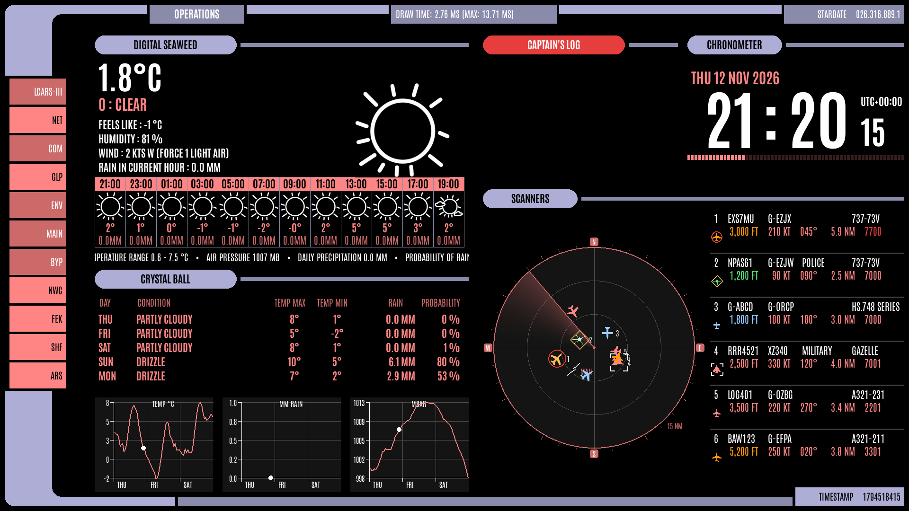
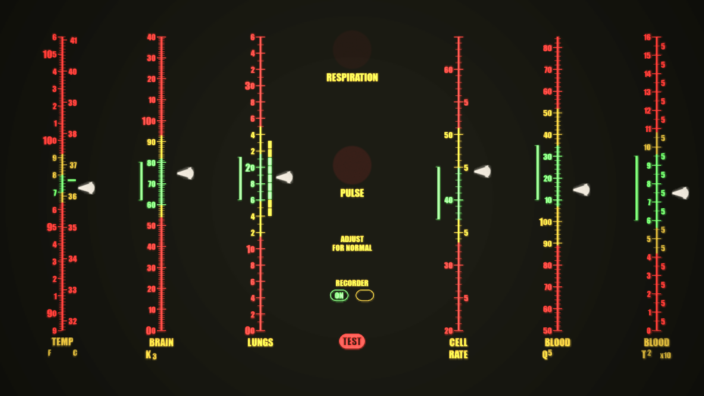

# LCARS display

A Star Trek LCARS-style display for a Raspberry Pi, written in Python with pygame. It fills
a 1920×1080 screen and shows one of three screens at a time, changed with push buttons on
the Pi's GPIO pins or the arrow keys:

- **LCARS**: an ambient screen that sits there looking busy. It shows a clock, the weather
  forecast, your next Google Calendar events, the Pi's CPU and memory use, and a radar of the
  aircraft near you from your own ADS-B receiver.
- **DeviantArt frame**: a picture frame. Every day it downloads 30 new landscape pictures
  from DeviantArt, chosen from artists, topics and tags you name, and shows them one after
  another, each fading into the next, with the title and artist in the corner.
- **Biomonitor**: the sickbay biomonitor, with a row of dials whose pointers drift around
  their normal ranges, and lamps that flash with the breathing and the heartbeat (which you
  can hear).

Each screen is in its own folder, and new ones can be added (see [Adding a screen](#adding-a-screen)).


*The LCARS screen, with the weather, the forecast and the aircraft radar. These aircraft are
the made-up ones from its test mode, one of them squawking an emergency, which turns the
screen red.*


*The biomonitor screen.*

## What you need

- A Raspberry Pi (it was written on a Pi 5) running Raspberry Pi OS, with a 1920×1080 screen
  on HDMI. It runs without a desktop, drawing straight to the screen.
- Optional: three push buttons on the GPIO pins (see [Buttons](#buttons)). A keyboard does
  the same.
- Optional: an ADS-B receiver running dump1090 (for example a Flightradar24 feeder) for the
  aircraft radar.
- Optional: a DeviantArt API key for the picture frame, and a Google account for the calendar.

Anything that is missing is left blank or says so on the screen; the rest still works.

## Installing

On the Pi:

```bash
git clone https://github.com/g0hjq/lcars.git ~/lcars3
cd ~/lcars3

# Python packages (pygame, numpy, psutil and gpiozero; Pillow is optional)
sudo apt install python3-pygame python3-numpy python3-psutil python3-gpiozero python3-lgpio python3-pil

# For the Google Calendar (optional)
pip install --break-system-packages google-api-python-client google-auth-httplib2 google-auth-oauthlib

# Your own settings
cp my_settings_example.py my_settings.py
nano my_settings.py
```

The service file and the scripts expect the project to be in `/home/pi/lcars3` and the user
to be `pi`. If yours are different, change them in `lcars.service`.

## Setting it up

### Your location and receiver: `my_settings.py`

| Setting | What it is |
| --- | --- |
| `HOME_LAT`, `HOME_LON` | where your ADS-B receiver is, in degrees. The radar is centred here. |
| `WEATHER_LAT`, `WEATHER_LON` | where the weather forecast is for |
| `AIRCRAFT_URL` | the `aircraft.json` of your dump1090, such as `http://192.168.1.10/dump1090/data/aircraft.json` |

The weather comes from [Open-Meteo](https://open-meteo.com/), which needs no key. The airport
marked on the radar (Manchester) is set at the top of `lcars_frame/lcars_screen.py`.

### DeviantArt pictures

1. Log in to DeviantArt and register an application at
   <https://www.deviantart.com/developers/register>.
2. Put its client_id and client_secret in `deviantart_frame/deviantart_key.txt`, on two lines:
   ```
   12345
   0123456789abcdef0123456789abcdef
   ```
3. Check the key works, and list the topics there are to choose from:
   ```bash
   python3 -m deviantart_frame.deviantart_library topics
   ```
4. Choose what it shows in `deviantart_frame/deviantart_choices.txt`, which is made, with
   instructions in it, the first time it runs. You can name artists, topics and tags, and say
   whether mature pictures are allowed. With none named, it shows the Daily Deviations and the
   most popular pictures.

It keeps the newest 400 pictures in `deviantart_frame/pictures/deviantart/` (`PICTURE_COUNT`
and `KEEP_COUNT` in `deviantart_frame/deviantart_library.py`). Your own pictures can go in
`deviantart_frame/pictures/my_own/`, and are mixed in with them (unless `OWN_PICTURES` in
`deviantart_frame/deviantart_frame.py` is set to `False`).

### Google Calendar

1. In the [Google Cloud Console](https://console.cloud.google.com/), make a project and enable
   the **Google Calendar API**.
2. Set up the OAuth consent screen ("External", with yourself as a test user, is fine).
3. Create an OAuth client ID of type **Desktop app**, download its JSON, and save it as
   `lcars_frame/credentials.json`.
4. Run it once on a machine with a browser. It asks you to sign in and allow read-only access
   to your calendar, then saves `lcars_frame/token.json`. After that it carries on by itself.

## Running it

It runs as a systemd service called `lcars`. To install the service the first time:

```bash
sudo cp lcars.service /etc/systemd/system/
sudo systemctl daemon-reload
```

Then:

```bash
./enable_service.sh     # start it now, and at every boot
./disable_service.sh    # stop it, and don't start it at boot
journalctl -u lcars -f  # see what it is doing
```

If it stops or crashes, the service starts it again after 5 seconds. To run it by hand
instead, so its messages come out in your terminal:

```bash
./disable_service.sh
SDL_VIDEODRIVER=kmsdrm python3 lcars.py
```

## Buttons

Each button is wired between its GPIO pin and a ground pin. The Pi's own pull-up resistors are
used, so nothing else is needed.

| Button | Pin | Key | What it does |
| --- | --- | --- | --- |
| PREVIOUS | GPIO22 (pin 15) | Left arrow | previous screen |
| NEXT | GPIO17 (pin 11) | Right arrow | next screen |
| OK, pressed briefly | GPIO27 (pin 13) | Enter or space | DeviantArt frame: next picture |
| OK, held for 2 seconds | GPIO27 (pin 13) | Delete | DeviantArt frame: delete the picture shown, so it isn't seen again |
| | | Esc or Q | quit (the service starts it again) |

Ground is pin 9, 14 or 20.

## Files

```
lcars.py                 starts it: the list of screens, and the main loop
screens.py               switching between the screens; the screen size
gpio_buttons.py          the push buttons
fonts.py, fonts/         the Antonio font every screen uses
settings.py              reads my_settings.py (or my_settings_example.py if it isn't there)
my_settings_example.py   made-up settings, to copy to my_settings.py
lcars.service            the systemd service
enable_service.sh        start the service, and at boot
disable_service.sh       stop the service, and not at boot
lcars_frame/             the LCARS screen, and the weather, calendar and aircraft it shows
deviantart_frame/        the DeviantArt picture frame, and its downloader
biomonitor_frame/        the biomonitor screen, with its pointer, font and heartbeat
```

These hold keys, logins or your own settings, or are made as it runs, so they are left out of
the repository (see `.gitignore`):

- `my_settings.py`
- `deviantart_frame/deviantart_key.txt`
- `lcars_frame/credentials.json` and `lcars_frame/token.json`
- `deviantart_frame/deviantart_choices.txt`
- `deviantart_frame/pictures/`

## Adding a screen

1. Make a folder for it, like `biomonitor_frame`, with an empty `__init__.py` in it.
2. In a file in that folder, write a class based on `screens.Screen`:
   ```python
   import screens

   class MyScreen(screens.Screen):
       name = "MINE"

       def update(self, visible):
           ...     # every frame, whether it is shown or not

       def draw(self, surface):
           ...     # draw the whole screen on the surface
   ```
3. Add one of it to the list of screens in `main()` in `lcars.py`.

It can also react to the buttons with `handleEvent(self, event)`, which gets the `OK_PRESSED`
and `OK_HELD` events from `screens.py`.

## Made with Claude Code

This project was written with help from [Claude Code](https://claude.com/claude-code),
Anthropic's AI coding assistant. It was used to write and change the code, track down
bugs, set it up to start when the Pi boots, and get it ready for GitHub (including this
README and its screenshots), with the ideas, the testing and the final say coming from me.

## Credits

- The [Antonio](https://fonts.google.com/specimen/Antonio) font is under the SIL Open Font
  License (`fonts/OFL.txt`).
- Weather from [Open-Meteo](https://open-meteo.com/); aircraft details from [adsbdb](https://www.adsbdb.com/).
- The downloaded pictures belong to their artists on DeviantArt, and are credited on screen.
- LCARS and Star Trek belong to Paramount. This is a fan project, not connected with them.
